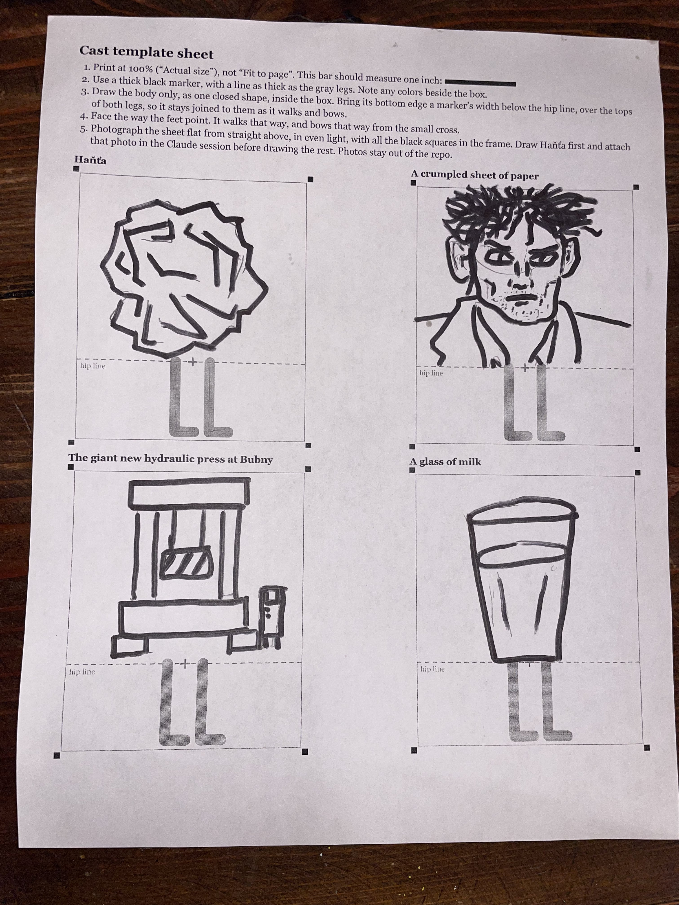

# How the cast gets made

The site's characters are hand-drawn. Josh draws each body in marker on the template sheet, an agent inks it into an SVG, and he approves the result. Read this before making or changing a cast member.

- [`template-sheet.pdf`](template-sheet.pdf): the blank sheet, US Letter. Print it at 100%. It comes from `TemplateSheet.tsx`, so reprint from `/skill/template-sheet/` under `pnpm dev` if the rig changes.
- [`photos/`](photos/): the drawings as drawn, including anything that later changed.
- [`tools/`](tools/): the scripts that made the first cast.



## Steps

1. **Get the photo in.** Convert it with `tools/convert-photo.py`. This is the only way a photo enters the repo: `.gitignore` blocks every other JPEG, HEIC and video, and the script removes the phone's model, time and place. Look at the result for anything personal in frame. Commit it only once its cast is public, since an unpublished piece's cast is a draft.
2. **Square up each box.** `rectify.py` finds the sheet's black corner squares and warps each box to rig units. Its corner positions are read by eye from a 1200-wide view, so update them for each photo. It scales them with `f = w / 1200`, so check the photo's real width first.
3. **Ink each body.** Choose per body, and compare them side by side at full size and at parade size:
   - **Trace** (`trace.py`, then `hanta.py` for hand fixes) when the marker line is the character. Haňťa is traced, because redrawing him lost the scowl.
   - **Redraw** as SVG in `bodies.mjs` when simple shapes hold up, which is lighter. The paper, press and milk are redrawn.
4. **Write it into the site.** `gen.mjs <repo>` writes `src/components/cast/registry.tsx` and `hanta-lines.ts`. Each body gets its own `Gait` there. Check the page weight: Haňťa is about 18 KB of path data, twice per page.
5. **Show Josh a proof.** `proof.mjs` puts the photo beside the ink at both sizes. He approves each body, then check it in dark mode, where the cast has a light edge.

## Traps

- `potrace.Bitmap` reads True as white, so pass the inverted mask: `potrace.Bitmap(~mask)`.
- A photo's size depends on how it's rotated, so read it rather than assume portrait.
- These scripts were written for one cast. They run from a folder holding the working images and assume the first cast's names, so expect to edit them.

## Setup

```bash
python3 -m venv .venv && .venv/bin/pip install -r docs/cast/tools/requirements.txt
```

Keep the venv and working images outside the repo. `proof.mjs` needs Playwright's Chromium: `pnpm exec playwright install --only-shell chromium`.
